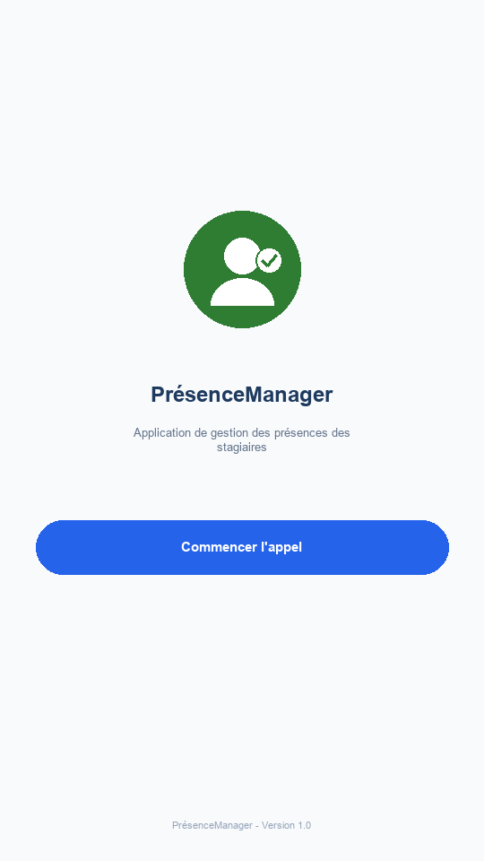
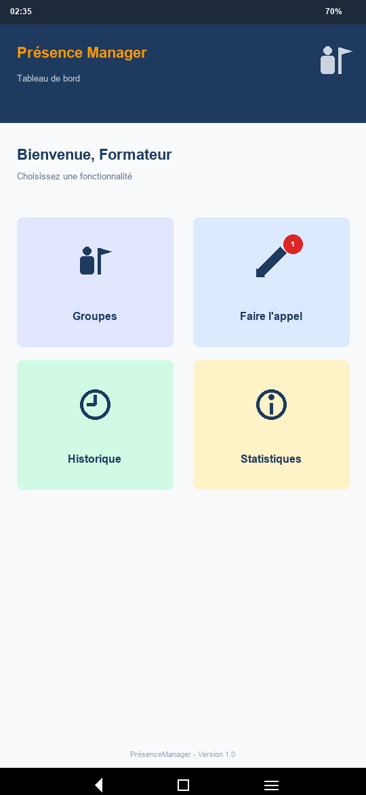
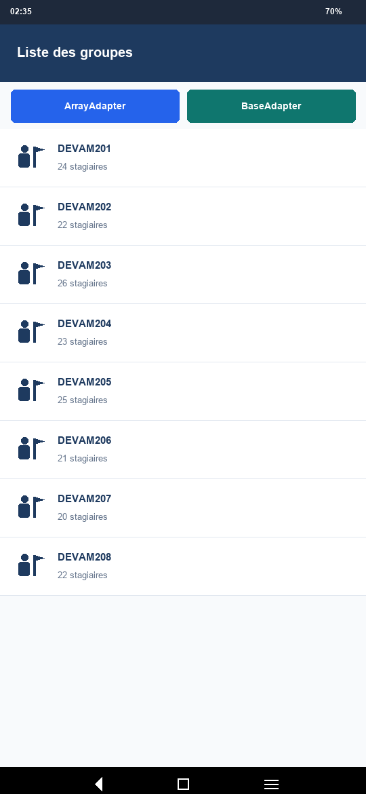
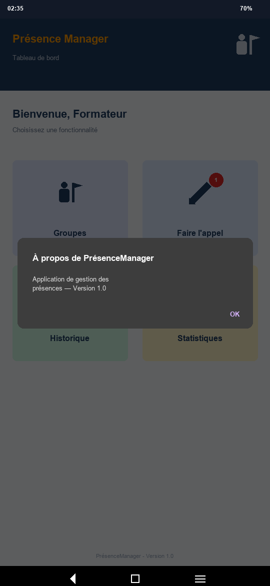
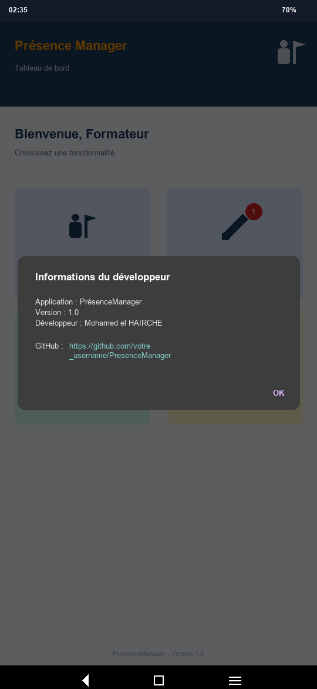

# PrésenceManager 📱

## 📌 1. Présentation du Projet
**PrésenceManager** est une application mobile Android native complète développée dans le cadre du module **M203 / M205 — Développement des interfaces utilisateurs sous Android** (Filière Développement Digital, Option Applications Mobiles).

L'application offre une solution moderne et ergonomique pour la gestion de la présence des stagiaires, intégrant la gestion avancée des événements utilisateur, des menus contextuels (CAB & PopupMenu) et une comparaison dynamique des adaptateurs de listes (`ArrayAdapter` vs `BaseAdapter` avec le patron `ViewHolder`).

---

## 🚀 2. Vue d'Ensemble des Travaux Pratiques (TP01 à TP05)

| TP | Intitulé | Description & Fonctionnalités clés |
| :---: | :--- | :--- |
| **TP01** | **Interface d'accueil** | Écran de bienvenue avec logo, titre, description, bouton d'entrée et version. |
| **TP02** | **Tableau de bord** | Grille 2x2 réactive avec en-tête utilisateur, message de bienvenue et 4 cartes de fonctionnalités (Groupes, Faire l'appel, Historique, Statistiques). |
| **TP03** | **Gestion des événements** | Navigation par clics simples, appuis longs (`Toast`), double-clic sur profil (`AlertDialog` "À propos") et liens hypertexte (`Linkify`). |
| **TP04** | **Actions contextuelles** | Integration de la barre d'actions contextuelle (**CAB - Contextual Action Bar**) et du menu flottant (**Pop-up Menu**) via des fichiers Menu XML dédiés. |
| **TP05** | **ListView & Adaptateurs** | Comparaison dynamique entre `ArrayAdapter` (liste simple) et `BaseAdapter` (liste personnalisée enrichie avec le patron `ViewHolder`). |

---

## 🛠️ 3. Technologies, Langages et Architecture

### 🔤 Langages de Programmation
* **Kotlin** : Logique métier, gestion des activités (`AppCompatActivity`), Intents explicites, listeners d'événements, `ActionMode.Callback`, et adaptateurs personnalisés (`BaseAdapter`).
* **XML** : Conception des interfaces utilisateur (ConstraintLayout, LinearLayout, GridLayout), styles, drawables vectoriels et ressources de menu (`res/menu/`).
* **Markdown** : Documentation complète et structurée du projet (`README.md`).

### 🧰 Environnement & Outils
* **Android Studio** : Environnement de développement intégré (IDE) officiel Android.
* **Gradle** : Moteur d'automatisation de génération (Build System).
* **Git & GitHub** : Contrôle de version distribué et hébergement distant du dépôt.

### ⚙️ Composants Framework Android
* **Activités** : `MainActivity`, `DashboardActivity`, `GroupesActivity`, `AppelActivity`, `HistoriqueActivity`, `StatistiquesActivity`.
* **Composants de Listes** : `ListView`, `BaseAdapter`, `ArrayAdapter`, patron `ViewHolder`, `convertView` (recyclage optimisé de vues).
* **Menus & Actions** : `ActionMode`, `PopupMenu`, `AlertDialog.Builder`, `Toast`.
* **Navigation & Utilitaires** : `Intent` explicites, `Linkify`, `LinkMovementMethod`, `GestureDetector`.

---

## 📱 4. Détail et Fonctionnalités par TP

### 🔹 TP01 — Écran d'accueil (`MainActivity`)
- Point d'entrée de l'application avec le logo officiel `PrésenceManager`.
- Bouton *"Commencer l'appel"* ouvrant le Tableau de bord.

### 🔹 TP02 — Tableau de bord (`DashboardActivity`)
- En-tête bleu nuit (`#1E3A5F`) avec le nom de l'application en orange (`#FF9800`) et la photo de profil (`imgProfil`).
- Grille 2x2 comprenant 4 cartes colorées avec icônes vectorielles officielles et badge d'appel.

### 🔹 TP03 — Événements & Navigation
- **Clic simple** sur les cartes ➔ Navigation vers l'activité correspondante.
- **Appui long** sur Groupes & Faire l'appel ➔ Affiche un message d'aide `Toast`.
- **Double-clic** sur la photo de profil ➔ Affiche le dialogue *"À propos de PrésenceManager"*.
- **Clic sur la version 1.0** ➔ Affiche le dialogue *"Informations du développeur"* avec lien GitHub interactif (`Linkify`).

### 🔹 TP04 — Barre Contextuelle (CAB) & Pop-up Menu
- **Bouton CAB** (`#2563EB`) ➔ Active la barre d'action contextuelle temporaire en haut de l'écran avec les actions *"Afficher"* (AlertDialog) et *"Terminer"*.
- **Bouton Pop-up** (`#0F766E`) ➔ Ouvre un menu contextuel flottant avec *"Ouvrir Groupes"* et *"Informations"*.

### 🔹 TP05 — ListView & Comparaison des Adaptateurs (`GroupesActivity`)
- **Bouton ArrayAdapter** (Bleu `#2563EB`) ➔ Charge une liste simple de chaînes (`DEVAM201` à `DEVAM210`) avec notification `Toast` au clic.
- **Bouton BaseAdapter** (Vert `#0F766E`) ➔ Charge une liste personnalisée enrichie avec la classe `Groupe(nom, effectif)`, l'icône, le nombre de stagiaires et une boîte `AlertDialog` au clic.

---

## 📸 5. Galerie Complète des Captures d'Écran (TP01 à TP05)

### 🏠 Écran d'accueil & Tableau de bord (TP01 & TP02)
| Écran d'accueil (`MainActivity`) | Tableau de bord (`DashboardActivity`) |
| :---: | :---: |
|  |  |

### ⚡ Actions contextuelles CAB & Pop-up (TP04)
| Barre d'actions contextuelle (CAB) | Menu flottant (Pop-up Menu) |
| :---: | :---: |
|  |  |

### 📂 Comparaison des adaptateurs de liste (TP05)
| Mode BaseAdapter (Liste personnalisée) | Mode ArrayAdapter (Liste simple) |
| :---: | :---: |
|  |  |

### 💬 Boîtes de Dialogue & Modals (TP03)
| Dialogue "À propos" (Double-clic profil) | Dialogue "Informations Développeur" |
| :---: | :---: |
|  |  |

---

## 👨‍💻 6. Informations du Développeur
* **Auteur** : Mohamed el HAIRCHE
* **Filière** : Développement Digital — Option Applications Mobiles
* **Module** : M203 / M205 — Développement des interfaces utilisateurs sous Android
* **Version** : 1.0
* **Dépôt GitHub** : [PresenceManager sur GitHub](https://github.com/Mohamed22-Dev/PresenceManager)
