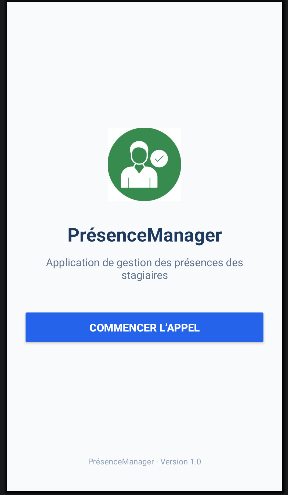

# PrésenceManager 📱

## 📌 Description
PrésenceManager est une application Android destinée à faciliter la gestion des présences des stagiaires.

Ce projet est réalisé dans le cadre du TP01 du module M203 — Interfaces utilisateurs Android.

## 🎯 Objectif
Créer une interface d'accueil simple et moderne permettant de présenter l'application et de préparer la gestion des présences.

## 🛠️ Technologies utilisées
- Kotlin
- XML
- Android Studio

## 🖥️ Interface d'accueil

L'écran d'accueil contient :
- Le logo de l'application.
- Le titre PrésenceManager.
- Une description de l'application.
- Un bouton « Commencer l'appel ».
- La version de l'application.

## 📸 Capture d'écran

## 👨‍💻 Projet
**TP01 : Création de l'interface d'accueil — PrésenceManager**

Version : 1.0
