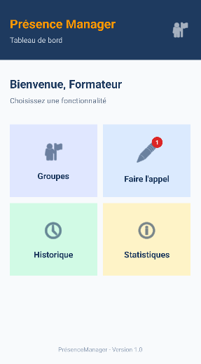
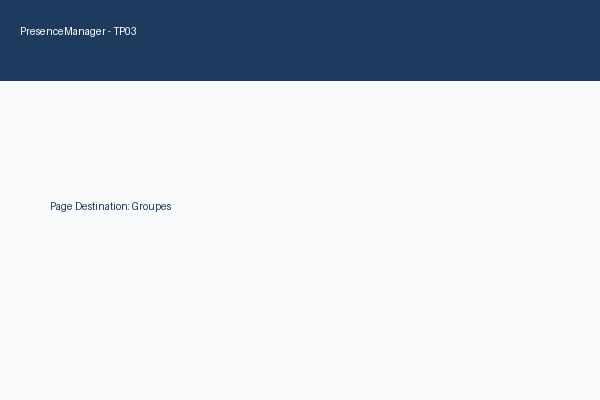
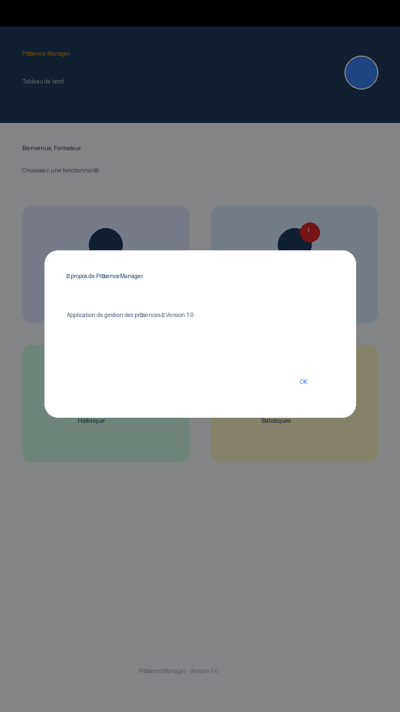
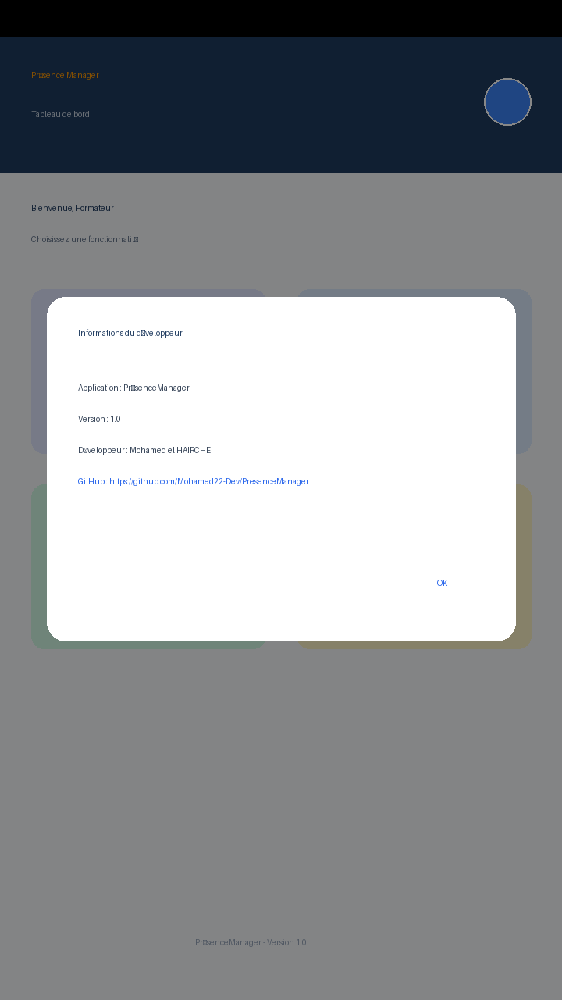

# PrésenceManager 📱

## 📌 Description du Projet
**PrésenceManager** est une application mobile Android native conçue pour faciliter la gestion de la présence des stagiaires au sein des établissements de formation. 

Ce projet s'inscrit dans le cadre des Travaux Pratiques (**TP01**, **TP02** et **TP03**) du module **M203 — Développement d'Applications Mobiles** (Filière Développement Digital).

---

## 🛠️ Langages, Outils et Technologies Utilisés

### 🔤 1. Langages de Programmation
* **Kotlin** : Langage principal utilisé pour programmer toute la logique applicative, la gestion des activités, la navigation et les écouteurs d'événements.
* **XML (Extensible Markup Language)** : Langage de balisage utilisé pour structurer les interfaces utilisateur (Layouts), définir les styles, couleurs et drawables.
* **Markdown** : Langage de rédaction pour la documentation du projet (`README.md`).

### 🧰 2. Environnement et Outils de Développement
* **Android Studio** : Environnement de développement intégré (IDE) officiel pour Android.
* **Gradle** : Moteur d'automatisation de génération (Build Automation Tool) de l'application Android.
* **Git & GitHub** : Système de contrôle de version distribué pour le suivi des modifications et le stockage distant du dépôt.
* **Android SDK & ADB** : Ensemble d'outils et d'API pour le débogage et le déploiement sur émulateur.

### ⚙️ 3. Composants et APIs Android Framework
* **`AppCompatActivity`** : Classe de base pour les activités garantissant la compatibilité avec les versions antérieures d'Android.
* **`Intent` (Explicite)** : Objet de messagerie utilisé pour naviguer de façon explicite entre les différentes activités (`MainActivity` ➔ `DashboardActivity` ➔ Écrans de destination).
* **`OnClickListener`** : Écouteur d'événements gérant les clics simples sur les boutons, cartes et éléments textuels.
* **`OnLongClickListener`** : Écouteur gérant les appuis maintenus (long click) avec retour booléen (`true`) pour consommer l'événement sans déclencher le clic simple.
* **`GestureDetector` & `SimpleOnGestureListener`** : Composant de détection des gestes avancés permettant d'intercepter spécifiquement le **double-clic (`onDoubleTap`)**.
* **`AlertDialog.Builder`** : Composant pour construire et afficher des boîtes de dialogue pop-up interactives ("À propos" et "Informations du développeur").
* **`Toast`** : Notification éphémère affichant des messages courts d'information à l'écran.
* **`Linkify` & `LinkMovementMethod`** : API permettant de détecter automatiquement les URLs dans un texte (`Linkify.WEB_URLS`) et d'ouvrir le navigateur web lors d'un clic.
* **Layouts XML (`ConstraintLayout`, `GridLayout`, `LinearLayout`, `CardView`)** : Structures de mise en page réactives et ergonomiques.

---

## 📱 Description Détaillée des Écrans et Fonctionnalités

### 1️⃣ Écran d'accueil (`MainActivity`)
* **Fonction** : Point d'entrée de l'application (TP01).
* **Composants** : Logo `PrésenceManager`, Titre principal, Description, Bouton `Commencer l'appel`, Pied de page.
* **Interactions & Événements** :
  * **Clic simple sur `btnCommencer`** : Déclenche un `Intent` explicite pour ouvrir le Tableau de bord (`DashboardActivity`).
  * **Clic simple sur `txtFooter` ("PrésenceManager - Version 1.0")** : Affiche la boîte de dialogue *"Informations du développeur"*.

### 2️⃣ Tableau de Bord (`DashboardActivity`)
* **Fonction** : Écran central de navigation (TP02 & TP03).
* **Composants** : En-tête avec nom de l'application et photo de profil (`imgProfil`), Message de bienvenue, Grille 2x2 de 4 cartes interactives, Pied de page.
* **Interactions & Événements** :
  * **Clics simples (`OnClickListener`) sur les cartes** :
    * `cardGroupes` ➔ Ouvre `GroupesActivity`.
    * `cardAppel` ➔ Ouvre `AppelActivity`.
    * `cardHistorique` ➔ Ouvre `HistoriqueActivity`.
    * `cardStatistiques` ➔ Ouvre `StatistiquesActivity`.
  * **Appui long (`OnLongClickListener`) sur les cartes** :
    * `cardGroupes` ➔ Affiche un message Toast : *"Groupes : sélectionner ou consulter les groupes"*.
    * `cardAppel` ➔ Affiche un message Toast : *"Faire l'appel : démarrer une séance"*.
  * **Double-clic (`onDoubleTap`) sur la photo de profil (`imgProfil`)** :
    * Utilise un `GestureDetector` pour détecter deux clics rapides et ouvrir la boîte de dialogue *"À propos de PrésenceManager"*.
  * **Clic simple sur `txtFooterDashboard`** : Affiche la boîte de dialogue *"Informations du développeur"*.

### 3️⃣ Écrans de Destination (`GroupesActivity`, `AppelActivity`, `HistoriqueActivity`, `StatistiquesActivity`)
* **Fonction** : Écrans cibles de chaque fonctionnalité du tableau de bord.
* **Présentation** : Fond d'écran `#F8FAFC`, titre centré `#1E3A5F` en 24sp gras et message *"Fonctionnalité en cours de développement"* en 16sp.

### 4️⃣ Boîtes de Dialogue Pop-Up (AlertDialog)
* **Boîte de dialogue "À propos"** : Titre *"À propos de PrésenceManager"*, Message *"Application de gestion des présences — Version 1.0"*, Bouton OK.
* **Boîte de dialogue "Informations du développeur"** : Affiche le nom du développeur (*Mohamed el HAIRCHE*), la version et un lien URL vers le dépôt GitHub cliquable directement.

---

## 📸 Captures d'écran du Projet (TP03)

| 1. Tableau de Bord (`DashboardActivity`) | 2. Page de Destination (Clic Simple) |
| :---: | :---: |
|  |  |

| 3. Dialogue Double-clic (`imgProfil`) | 4. Dialogue Développeur (`Version 1.0`) |
| :---: | :---: |
|  |  |

---

## 👨‍💻 Auteur & Informations
* **Filière** : Développement Digital — Option Applications Mobiles
* **Développeur** : Mohamed el HAIRCHE
* **Version** : 1.0
* **Dépôt GitHub** : [PresenceManager sur GitHub](https://github.com/Mohamed22-Dev/PresenceManager)
