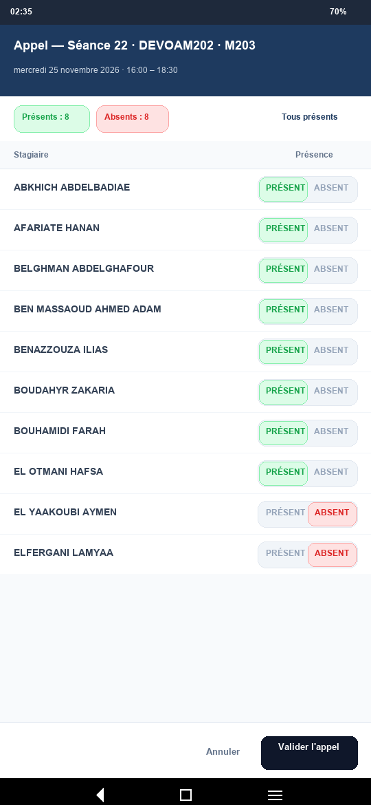
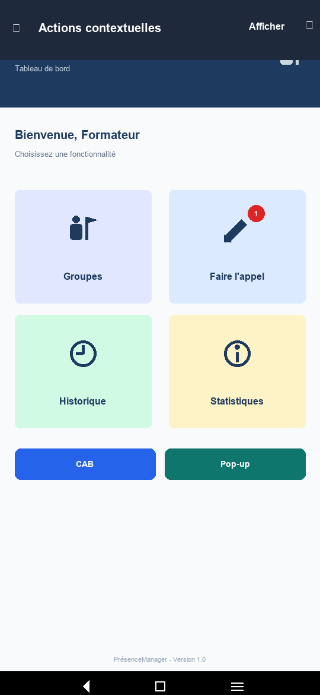
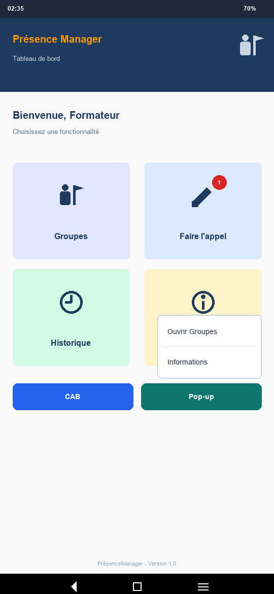

# PrésenceManager 📱

## 📌 1. Présentation du Projet
**PrésenceManager** est une application mobile Android native conçue pour la gestion de la présence des stagiaires au sein des établissements de formation (Module M203/M205).

---

## 🚀 2. Vue d'Ensemble des Fonctionnalités & TP

| Section | Description |
| :---: | :--- |
| **TP01 - Accueil** | Écran de bienvenue avec logo, titre, description et bouton d'entrée. |
| **TP02 - Dashboard** | Grille 2x2 réactive (Groupes, Faire l'appel, Historique, Statistiques). |
| **TP03 - Événements** | Clics simples, appuis longs (`Toast`), double-clic profil (`AlertDialog`), liens hypertexte. |
| **TP04 - Menus Contextuels** | Barre contextuelle (**CAB**) et menu flottant (**Pop-up Menu**). |
| **TP05 - ListView** | Comparaison dynamique entre `ArrayAdapter` (Bleu) et `BaseAdapter` (Vert). |
| **Séance d'Appel (`RecyclerView`)** | Gestion dynamique de la présence des stagiaires pour la classe **DEV202** (DEVOAM202) avec boutons `PRÉSENT` / `ABSENT`, compteurs dynamiques, `Tous présents` et validation. |

---

## 📱 3. Gestion de l'Appel par Groupe avec `RecyclerView` (`DEVOAM202`)
Au clic sur le groupe **DEV202** (DEVOAM202) dans la liste des groupes, l'application ouvre l'interface dynamique d'appel :
- **Composant principal** : `RecyclerView` alimenté par `StagiaireAdapter`.
- **Modèle de données** : `Stagiaire(val nom: String, var isPresent: Boolean)`.
- **Badges interactifs** : Mise à jour en temps réel des compteurs `Présents` (vert) et `Absents` (rouge).
- **Action *"Tous présents"*** : Marque l'ensemble des stagiaires présents en un clic.
- **Bouton *"Valider l'appel"*** : Affiche le bilan de la séance via une boîte `AlertDialog`.

---

## 📸 4. Galerie des Captures d'Écran

### 📋 1. Gestion de l'Appel avec `RecyclerView` (`DEVOAM202`)
| Interface d'Appel des Stagiaires (`RecyclerView`) |
| :---: |
|  |

---

### 📂 2. Comparaison des Adaptateurs (`GroupesActivity`)
| Mode BaseAdapter (Liste personnalisée) | Mode ArrayAdapter (Liste simple) |
| :---: | :---: |
|  |  |

---

### ⚡ 3. Actions Contextuelles CAB & Pop-up
| Barre contextuelle (CAB) | Menu flottant (Pop-up Menu) |
| :---: | :---: |
|  |  |

---

## 👨‍💻 5. Informations du Développeur
* **Développeur** : Mohamed el HAIRCHE
* **Filière** : Développement Digital — Option Applications Mobiles
* **Version** : 1.0
* **Dépôt GitHub** : [PresenceManager sur GitHub](https://github.com/Mohamed22-Dev/PresenceManager)
