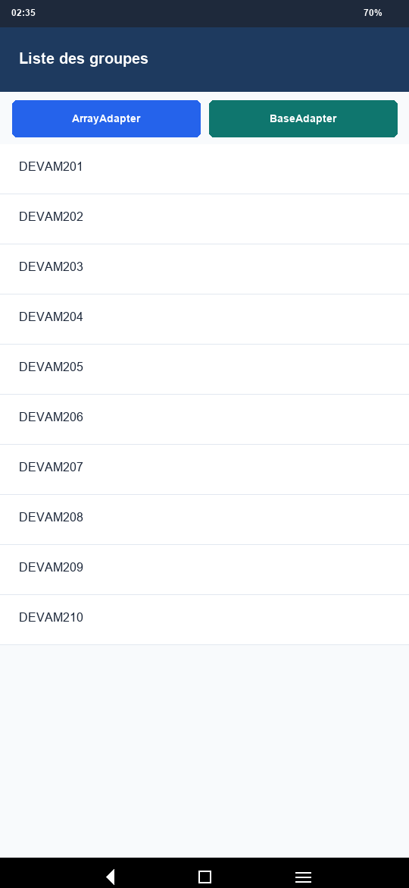

# PrésenceManager 📱

## 📌 Description du Projet
**PrésenceManager** est une application mobile Android native conçue pour faciliter la gestion de la présence des stagiaires au sein des établissements de formation. 

Ce projet regroupe l'ensemble des Travaux Pratiques (**TP01**, **TP02**, **TP03**, **TP04** et **TP05**) du module **M203 — Développement des interfaces utilisateurs sous Android** (Filière Développement Digital).

---

## 🎯 Objectifs du TP05 — Utiliser le ListView et comparer les adaptateurs
Implémentation et comparaison des deux modes d'affichage dans `GroupesActivity` :
1. **Mode `ArrayAdapter` (Liste simple)** :
   - Activé par le bouton **ArrayAdapter** (`#2563EB`).
   - Affiche les noms des groupes (`DEVAM201` à `DEVAM210`) avec la disposition système `android.R.layout.simple_list_item_1`.
   - Clic sur un élément : Affiche un message `Toast` contenant le nom du groupe.
2. **Mode `BaseAdapter` (Liste personnalisée avec `ViewHolder`)** :
   - Activé par défaut et via le bouton **BaseAdapter** (`#0F766E`).
   - Modèle de données : Classe `Groupe(val nom: String, val effectif: Int)`.
   - Adaptateur personnalisé : `GroupeAdapter` avec patron `ViewHolder`, recyclage `convertView`, icône et nombre de stagiaires.
   - Clic sur un élément : Affiche une boîte de dialogue `AlertDialog` avec le nom et l'effectif du groupe.

---

## 🛠️ Langages, Outils et Technologies Utilisés

### 🔤 1. Langages de Programmation
* **Kotlin** : Logique applicative, data class `Groupe`, `GroupeAdapter`, écouteurs et bascule d'adaptateurs.
* **XML (Extensible Markup Language)** : Layouts de l'activité (`activity_groupes.xml`) et ligne personnalisée (`item_groupe.xml`).
* **Markdown** : Documentation complète du projet (`README.md`).

### 🧰 2. Environnement et Outils de Développement
* **Android Studio** : IDE officiel Android.
* **Gradle** : Moteur de génération automatique.
* **Git & GitHub** : Gestion de versions et dépôt distant.

### ⚙️ 3. Composants et APIs Android Framework
* **`ListView` & `BaseAdapter`** : Affichage d'une liste défilante personnalisée optimisée par le patron `ViewHolder`.
* **`ArrayAdapter`** : Affichage simple d'un tableau de chaînes.
* **`AlertDialog.Builder` & `Toast`** : Retours visuels interactifs lors de la sélection.

---

## 📸 Captures d'Écran du TP05

| 1. Mode BaseAdapter (Liste personnalisée) | 2. Mode ArrayAdapter (Liste simple) |
| :---: | :---: |
|  |  |

---

## 👨‍💻 Auteur & Informations
* **Module** : M203 — Développement des interfaces utilisateurs sous Android
* **Développeur** : Mohamed el HAIRCHE
* **Version** : 1.0
* **Dépôt GitHub** : [PresenceManager sur GitHub](https://github.com/Mohamed22-Dev/PresenceManager)
