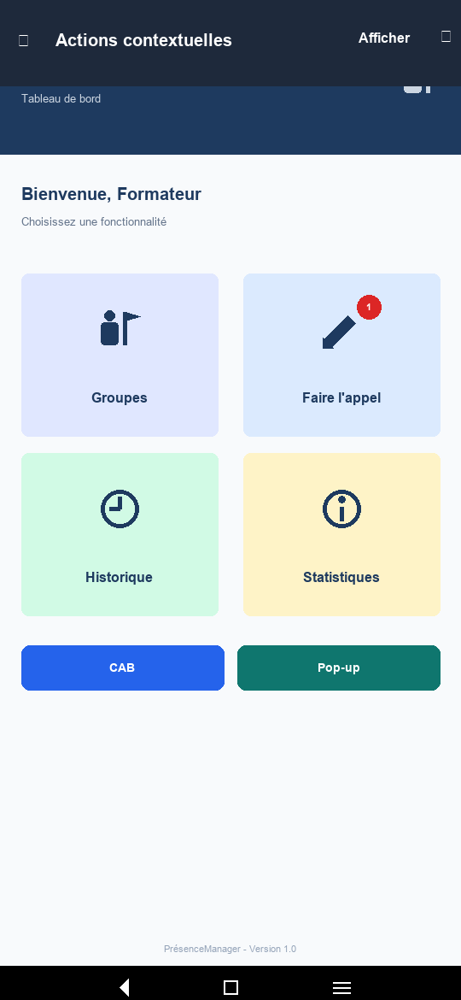
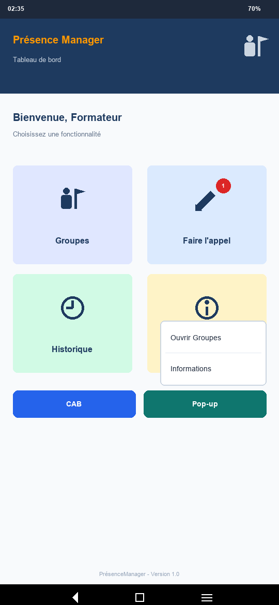

# PrésenceManager 📱

## 📌 Description du Projet
**PrésenceManager** est une application mobile Android native conçue pour faciliter la gestion de la présence des stagiaires au sein des établissements de formation. 

Ce projet regroupe l'ensemble des Travaux Pratiques (**TP01**, **TP02**, **TP03** et **TP04**) du module **M205 — Développer des interfaces utilisateurs sous Android** (Filière Développement Digital).

---

## 🎯 Objectifs du TP04 — Actions contextuelles (CAB & Pop-up)
Implémentation et gestion des menus contextuels en Kotlin :
1. **Barre d’actions contextuelle (CAB - Contextual Action Bar)** :
   - Déclenchée par le bouton **CAB** (`#2563EB`).
   - Utilise un `ActionMode.Callback` avec le menu XML `menu_cab_dashboard.xml`.
   - Action *"Afficher"* : Exécute une boîte de dialogue `AlertDialog`.
   - Action *"Terminer"* : Ferme la barre contextuelle (`mode.finish()`).
2. **Menu flottant (Pop-up Menu)** :
   - Déclenché par le bouton **Pop-up** (`#0F766E`).
   - Ancré sur le bouton avec `PopupMenu` et le menu XML `menu_popup_dashboard.xml`.
   - Action *"Ouvrir Groupes"* : Navigue vers `GroupesActivity`.
   - Action *"Informations"* : Affiche une boîte de dialogue `AlertDialog`.

---

## 🛠️ Langages, Outils et Technologies Utilisés

### 🔤 1. Langages de Programmation
* **Kotlin** : Logique applicative, gestion des activités, listeners et callbacks `ActionMode.Callback`.
* **XML (Extensible Markup Language)** : Layouts des vues et définitions des ressources de menu (`res/menu/`).
* **Markdown** : Documentation complète du projet (`README.md`).

### 🧰 2. Environnement et Outils de Développement
* **Android Studio** : IDE officiel Android.
* **Gradle** : System Automation Build.
* **Git & GitHub** : Gestion de version et hébergement du dépôt.

### ⚙️ 3. Composants et APIs Android Framework
* **`ActionMode` & `ActionMode.Callback`** : Gestion du cycle de vie de la CAB.
* **`PopupMenu`** : Affichage d'un menu flottant contextuel ancré à une vue.
* **`Intent` (Explicite)** : Navigation vers `GroupesActivity`.
* **`AlertDialog.Builder`** : Affichage des fenêtres d'information.
* **Layouts XML** : `ConstraintLayout`, `LinearLayout` horizontal pour les boutons de commande.

---

## 📱 Description Détaillée des Écrans et TP04

### 1️⃣ Tableau de Bord avec boutons CAB & Pop-up (`DashboardActivity`)
Le tableau de bord intègre deux boutons d'action sous la grille des cartes :
- **Bouton CAB** (`btnCab`) : Active la Contextual Action Bar en haut de l'écran.
- **Bouton Pop-up** (`btnPopup`) : Affiche le menu contextuel flottant.

---

## 📸 Captures d'Écran du TP04

| 1. Barre d'actions contextuelle (CAB) | 2. Menu flottant (Pop-up Menu) |
| :---: | :---: |
|  |  |

---

## 👨‍💻 Auteur & Informations
* **Module** : M205 — Développer des interfaces utilisateurs sous Android
* **Développeur** : Mohamed el HAIRCHE
* **Version** : 1.0
* **Dépôt GitHub** : [PresenceManager sur GitHub](https://github.com/Mohamed22-Dev/PresenceManager)
